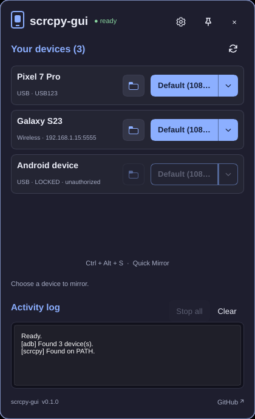
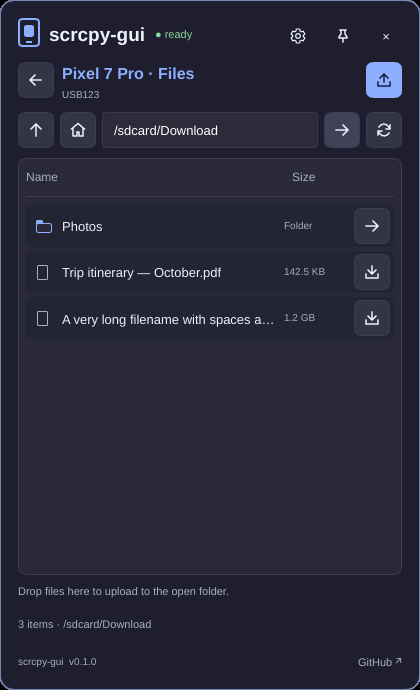
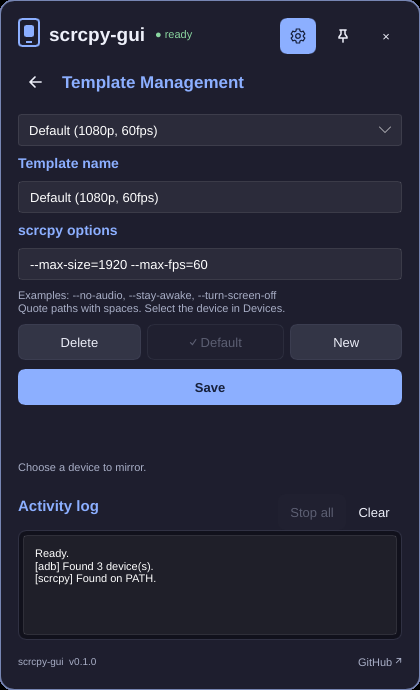

<div align="center">


# scrcpy-gui

**Mirror and control your Android phone from the system tray with one click.**

A small, fast tray app for [scrcpy](https://github.com/Genymobile/scrcpy) on Windows and Linux.

[](https://github.com/DeFerence3/scrcpy-gui-slint/releases/latest)
[](https://github.com/DeFerence3/scrcpy-gui-slint/actions/workflows/distribution.yml)

[](LICENSE.txt)

[Download](#download) · [Quick start](#quick-start) · [Features](docs/features.md) · [FAQ](#faq) · [Build from source](#build-from-source)

<br>

&nbsp;
&nbsp;


</div>

---

## Why scrcpy-gui?

[scrcpy](https://github.com/Genymobile/scrcpy) is excellent, but it runs from the command line. You type `adb devices`, remember the right flags, and do it again for each phone. scrcpy-gui puts all of that in your tray:

- 🖱️ **One-click mirroring.** Click a device and its screen appears on your desktop.
- ⌨️ **One key to start.** Press **Ctrl + Alt + S** (Windows) or your own key binding (Linux) to mirror the connected phone without opening anything.
- 🎛️ **Saved presets.** Keep your favorite scrcpy options (1080p60, light Wi-Fi mode, no audio, …) and switch between them from a dropdown.
- 📱 **Several devices at once.** USB and wireless devices, each in its own window, each stopped on its own.
- 📂 **Built-in file transfer.** Browse the phone's storage, download files, and upload by dragging them onto the panel.
- 🪶 **Light.** A native C++ app of a few megabytes. No browser engine, almost no memory use, instant start.
- 🔄 **Updates itself.** Optional automatic updates, each download checked against its SHA-256 digest.

See **[docs/features.md](docs/features.md)** for a full tour of every feature.

## Download

Get the latest version from the **[Releases page](https://github.com/DeFerence3/scrcpy-gui-slint/releases/latest)**:

| Platform | File | Notes |
|---|---|---|
| **Windows** (installer) | `scrcpy-gui-windows-x64.exe` | Recommended. No admin rights needed. Starts with Windows. |
| **Windows** (portable) | `scrcpy-gui-windows-x64.zip` | Extract anywhere and run `scrcpy-ui.exe`. |
| **Linux** x64 | `scrcpy-gui-linux-x64.tar.gz` | Extract into `~/.local`. Needs glibc 2.35+ (Ubuntu 22.04 or newer). |

> [!IMPORTANT]
> scrcpy-gui **does not include scrcpy or ADB**. Install them first:
> - **Windows:** download [scrcpy for Windows](https://github.com/Genymobile/scrcpy/blob/master/doc/windows.md) (it includes `adb.exe`), or run `winget install Genymobile.scrcpy`.
> - **Linux:** install `scrcpy` and `adb`/`android-tools` from your package manager, or see [scrcpy on Linux](https://github.com/Genymobile/scrcpy/blob/master/doc/linux.md).

### Install on Windows

Run the installer. The app starts in the tray right away and starts again each time you sign in. If you use the portable ZIP, keep all the extracted files together.

### Install on Linux

```sh
tar -xzf scrcpy-gui-linux-x64.tar.gz -C ~/.local
~/.local/bin/scrcpy-ui
```

This adds **scrcpy-gui** to your app launcher. You also need:

- a tray that supports StatusNotifierItem (Waybar, Quickshell/Omarchy, KDE Plasma, or GNOME with the AppIndicator extension), and
- an `xdg-desktop-portal` backend for file dialogs (for example `xdg-desktop-portal-gtk`).

## Quick start

1. **Enable USB debugging** on your phone: *Settings → About phone →* tap **Build number** 7 times, then *Developer options →* **USB debugging**.
2. **Connect the phone** by USB, unlock it, and tap **Allow** on the *Allow USB debugging?* prompt.
3. **Open scrcpy-gui** from the tray icon. Your phone appears under **Your devices**.
4. **Click the template button** on the device card (for example *Default (1080p, 60fps)*). The phone's screen opens in a new window, and you can control it with your mouse and keyboard.
5. **Click Stop** (or close the scrcpy window) when you're done.

If scrcpy isn't found, open **Settings** (gear icon) and click **Browse…** to point to `scrcpy.exe` or `scrcpy`.

### Set up a shortcut

- **Windows:** **Ctrl + Alt + S** works out of the box. Change it in **Settings → Keyboard shortcut**.
- **Linux:** Wayland doesn't let apps grab keys, so bind a key in your desktop to this command:

  ```sh
  scrcpy-ui --quick-mirror
  ```

  Hyprland example: `bind = SUPER CTRL, M, exec, scrcpy-ui --quick-mirror`. To start the app at login, add `scrcpy-ui --startup` to your autostart. See [more examples](docs/features.md#linux) for Sway, i3, GNOME and KDE.

With one phone connected, the shortcut starts mirroring right away. With several, the app asks which one to use.

## Tips

- **Mirror over Wi-Fi.** Pair the phone with `adb pair` / `adb connect` (or Android's *Wireless debugging*). It then appears in the list like a USB device.
- **Use a different preset once.** Click the **▾ arrow** next to the mirror button and pick a template.
- **Create your own presets.** **Settings → Manage templates** takes any [scrcpy option](https://github.com/Genymobile/scrcpy#user-documentation), for example `--turn-screen-off --stay-awake`.
- **Keep the panel open.** Click the **pin** icon.
- **Move files.** Click the **folder icon** on a device, then drag files onto the panel to upload, or click the download icon next to a file.

## FAQ

<details>
<summary><b>My phone doesn't appear, or shows "unauthorized".</b></summary>

Unlock the phone and accept the *Allow USB debugging?* prompt. If it doesn't appear, unplug and reconnect the phone, try another cable or port (some cables only charge), or click **Settings → Restart ADB**. On Windows, some phones need their manufacturer's USB driver.
</details>

<details>
<summary><b>The app says scrcpy wasn't found.</b></summary>

Install scrcpy (see [Download](#download)), then use **Settings → Detect PATH** or **Browse…** to pick the scrcpy executable. The app uses the `adb` that comes with scrcpy when there is one.
</details>

<details>
<summary><b>Mirroring starts and closes immediately.</b></summary>

Read the **Activity log** at the bottom of the panel; it shows scrcpy's error message. Common causes are a locked screen, an option your phone doesn't support (try the *Lightweight* template), or audio capture on Android 10 and older (add `--no-audio`).
</details>

<details>
<summary><b>Linux: there is no tray icon.</b></summary>

Your bar or desktop needs StatusNotifierItem support, for example Waybar's `tray` module, KDE, or GNOME with the *AppIndicator* extension. Without a tray, the panel stays open so you can still use the app.
</details>

<details>
<summary><b>Linux: the panel opens as a tiled window.</b></summary>

On Hyprland the app places itself automatically (floating, top right, on every workspace). On other compositors, add a float rule for the app id `scrcpy-gui`.
</details>

<details>
<summary><b>Does updating the app also update scrcpy?</b></summary>

No. **Settings → Check updates** updates scrcpy-gui only. Update scrcpy the way you installed it. On Linux, self-updating works for tarball installs in a folder you can write to, such as `~/.local`.
</details>

<details>
<summary><b>Where are my settings stored? How do I reset them?</b></summary>

Windows: `%APPDATA%\scrcpy-tray\settings.dat`. 

Linux: `~/.config/scrcpy-tray/settings.dat`. Quit the app and delete the file to reset everything.
</details>

## Documentation

| Document | What it covers |
|---|---|
| [Features](docs/features.md) | Every feature in detail, with platform differences |
| [Architecture](docs/architecture.md) | How the app is built, and why C++ and Slint |
| [Build on Windows](docs/build-windows.md) | Building, testing and packaging on Windows |
| [Build on Linux](docs/build-linux.md) | Building, testing, installing and packaging on Linux |

## Build from source

```sh
git clone https://github.com/DeFerence3/scrcpy-gui-slint.git
cd scrcpy-gui-slint
cmake -S . -B build -G Ninja -DCMAKE_BUILD_TYPE=Release
cmake --build build
```

You need CMake 3.21+, Ninja, a C++17 compiler and Rust, plus a few platform libraries. See the full guides for **[Windows](docs/build-windows.md)** and **[Linux](docs/build-linux.md)**.

## Contributing

Bug reports, ideas and pull requests are welcome. Please [open an issue](https://github.com/DeFerence3/scrcpy-gui-slint/issues) first for larger changes. Before you send code, read [docs/architecture.md](docs/architecture.md) for the project layout and rules, and run `ctest --test-dir build --output-on-failure`. For UI changes, include screenshots or the rendered previews from `build/ui-previews`.

## Acknowledgements

- [scrcpy](https://github.com/Genymobile/scrcpy) by Genymobile, which does all the real mirroring work
- [Slint](https://slint.dev), the UI toolkit this app is built with

## License

scrcpy-gui is free software under the [GNU General Public License v3.0](LICENSE.txt). It is not affiliated with Genymobile or the scrcpy project.
