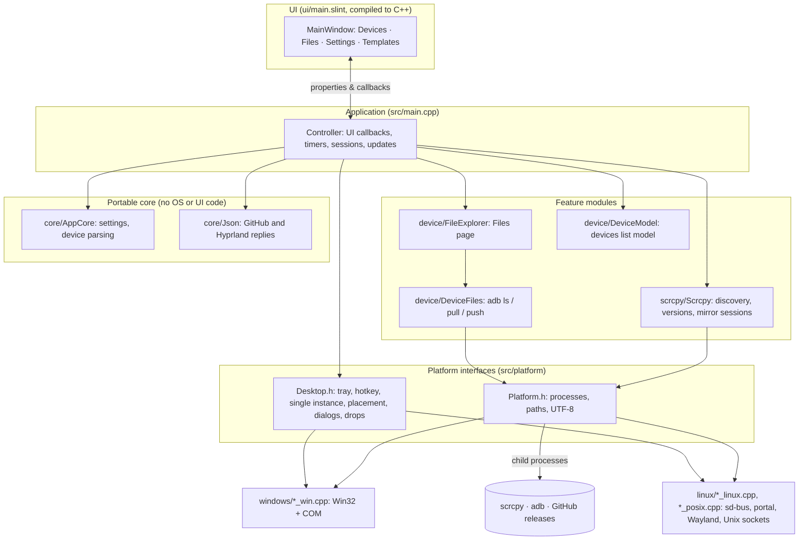

# Architecture

This document explains how scrcpy-gui is put together, why it is built this way, and why it uses C++ and Slint. Read it before you change the code. For build steps, see [build-windows.md](build-windows.md) and [build-linux.md](build-linux.md). For what the app does from a user's point of view, see [features.md](features.md).

- [Goals](#goals)
- [Tech stack and why](#tech-stack-and-why)
- [High-level design](#high-level-design)
- [Source layout](#source-layout)
- [Layers in detail](#layers-in-detail)
- [Threading model](#threading-model)
- [Platform integration](#platform-integration)
- [Settings storage](#settings-storage)
- [Self-update](#self-update)
- [Testing](#testing)
- [Build, packaging and release pipeline](#build-packaging-and-release-pipeline)
- [Contribution rules](#contribution-rules)

---

## Goals

The architecture follows from a few goals:

1. **Stay light.** A tray app runs all day. It should start instantly, use little memory and not pull in a browser engine or a large GUI framework.
2. **Wrap scrcpy, don't fork it.** [scrcpy](https://github.com/Genymobile/scrcpy) is actively developed. The app launches the user's own scrcpy and ADB as separate processes, so users upgrade scrcpy on their own schedule and the app never has to track scrcpy's internals.
3. **Feel native on each OS.** A real tray icon, a real global hotkey, native file dialogs and drag-and-drop from the system file manager. On Linux this means following freedesktop standards (StatusNotifierItem, xdg-desktop-portal) rather than one toolkit's version of them.
4. **Keep OS code contained.** Most of the logic is shared. Everything OS-specific sits behind two small interfaces, so supporting a platform means implementing those interfaces, not adding `#ifdef`s throughout the code.
5. **Be testable without a phone.** Device parsing, process handling, file transfers, startup and the updater can all be tested in CI with fake `adb`/`scrcpy` executables.

## Tech stack and why

| Part | Choice |
|---|---|
| Language | C++17 |
| UI | [Slint](https://slint.dev) 1.x (`.slint` markup compiled to C++) |
| Slint backend / renderer | winit + **software renderer** (no Qt, Skia or FemtoVG) |
| Build | CMake 3.21+ and Ninja; Slint fetched with `FetchContent` or used from a prebuilt SDK |
| Windows integration | Win32 + COM: `Shell_NotifyIcon`, `RegisterHotKey`, `IFileDialog`, OLE drag-and-drop |
| Linux integration | `sd-bus`/`sd-event` (libsystemd), `libwayland-client`, Unix sockets |
| Packaging | CPack: ZIP and NSIS installer on Windows, `.tar.gz` on Linux |
| Updates | `scripts/update.ps1` (Windows), `Updater_posix.cpp` with `curl`/`tar`/`sha256sum` (Linux) |
| Tests | CTest with plain C++ assertion programs and PowerShell scripts |

### Why Slint

- **Small and fast.** Slint compiles `ui/main.slint` into C++ at build time. No interpreter, no JavaScript runtime and no web view. The whole app is a few megabytes and starts immediately.
- **Low memory.** Slint can draw with a CPU software renderer. For a small panel this avoids loading GPU drivers, which on Linux cost about 90 MB of resident memory with the GL renderers. The Linux build turns the Qt backend and the Skia/FemtoVG renderers off for this reason (see `CMakeLists.txt`).
- **Declarative UI with type checking.** Layout, theme and reusable controls live in one `.slint` file. Properties and callbacks are checked when the project compiles, so a mistake between the UI and the C++ code is a build error, not a runtime surprise.
- **One UI on both platforms.** The same `.slint` file draws the panel on Windows and Linux. Only the tray, hotkey and file dialogs differ, and those are native on each OS anyway.
- **Headless previews.** The software renderer can draw the UI into images without a display. `scrcpy-ui-preview` uses this to render every screen and test clicks in CI. The screenshots in these docs come from it.
- **Licensing.** Slint is available under GPLv3, which matches this project's license.

**Alternatives considered:**

- **Electron or Tauri:** a bundled or system web engine is far heavier than a tray panel needs, both on disk and in memory.
- **Qt:** capable, but a large dependency to ship for one small window. On Linux it would also bring Qt's own tray and dialog layers when the goal is to talk to the desktop directly.
- **Native Win32 or GTK only:** two separate UIs to maintain, and no shared layout or theme.

### Why C++

- **Direct access to OS APIs.** The tray, hotkeys, COM file dialogs, OLE drag-and-drop, sd-bus and Wayland are all C or C++ APIs. Calling them directly avoids bindings and keeps each integration short.
- **First-class Slint support.** Slint's C++ API is official and generated code is plain C++ classes.
- **Simple process control.** The app's main job is starting, watching and stopping `adb` and `scrcpy` processes (and their child processes) and reading their output. That is straightforward with the native process APIs on each OS.
- **One small binary.** No runtime to install, a static core library, and only the Slint shared library next to the executable.

C++17 is enough: `std::filesystem`, `std::optional`, structured bindings and `std::thread` cover everything without needing a newer compiler.

## High-level design



The **Controller** in `main.cpp` is the only place that knows about both the UI and the modules. Feature modules don't include Slint-generated headers (except `FileExplorer`, which owns the Files page), and the core doesn't include any platform or UI headers.

## Source layout

```
src/
├── main.cpp                 Controller: wires UI, tray, hotkeys, timers and updates
├── core/                    Portable logic, no OS or UI dependencies
│   ├── AppCore.*            Settings model and file format, `adb devices -l` parsing
│   └── Json.*               Minimal JSON reader for GitHub and Hyprland replies
├── scrcpy/
│   └── Scrcpy.*             Finds scrcpy/adb, reads versions, starts and stops sessions
├── device/
│   ├── DeviceFiles.*        adb file operations: list, staged download, upload
│   ├── FileExplorer.*       The Files page: navigation, transfers, drops, cancel
│   └── DeviceModel.h        Slint model for the devices list, updated in place
└── platform/
    ├── Platform.h/.cpp      Portable process/path helpers (UTF-8 everywhere)
    ├── Desktop.h            Desktop integration interface
    ├── windows/             Platform_win.cpp, Desktop_win.cpp, FileDropTarget.*
    └── linux/               Platform_posix.cpp, Desktop_linux.cpp, Updater.*
ui/
├── main.slint               Window, pages, reusable controls and theme
└── icons/                   SVG icons, embedded into the binary
scripts/update.ps1           Windows self-updater (Check / Stage / Apply)
packaging/linux/             .desktop entry and SVG icon
cmake/                       NSIS installer template, MSVC environment helper
tests/                       C++ tests, fake tool executable, PowerShell tests, UI previews
```

CMake builds three targets from these:

- **`scrcpy-core`** (static library): `core/`, `platform/` and `device/DeviceFiles`. No Slint. Linked by both the app and the tests.
- **`scrcpy-widgets`** (static library): the compiled `ui/main.slint`, with icons embedded so portable copies need no asset folder.
- **`scrcpy-ui`** (executable): `main.cpp`, `Scrcpy`, `FileExplorer` and the platform's `Desktop_*` implementation.

## Layers in detail

### UI: `ui/main.slint`

One `MainWindow` with four pages (Devices, Settings, Templates, Files) and a shared header and footer. It holds UI state only: properties such as `devices`, `pinned`, `page`, `update-available`, and callbacks such as `start-mirror`, `browse-scrcpy`, `install-update`. The window always uses the dark color scheme. The UI contains no logic beyond enabling/disabling controls from its properties.

### Controller: `src/main.cpp`

A single `Controller` object:

- Loads and saves `Settings`, and connects every UI callback.
- Runs three timers on the UI thread: **focus** (100 ms, hides the panel on Windows when it loses focus unless it is pinned, on Files, or busy), **devices** (5 s, refreshes the list while the Devices page is visible and starts pending automatic installs), and **updates** (6 h).
- Tracks running mirror sessions by device serial and implements Quick Mirror (start right away with one ready device, otherwise ask).
- Parses command-line flags (`--startup`, `--quick-mirror`) and claims the single-instance lock before creating any window.

### Feature modules

- **`Scrcpy`** finds `scrcpy` (saved path, then `PATH`), resolves `adb` (next to scrcpy, then `PATH`), runs `adb devices -l`, restarts ADB and starts one scrcpy process per serial. Each session has a `Cancel` token, so stopping one device ends only its process tree. Session output goes to the activity log, and the end of a session is reported back to the UI.
- **`DeviceFiles`** wraps `adb shell ls`, `adb pull` and `adb push`. Downloads go to a temporary file beside the destination and are moved into place only on success, so a failed transfer never overwrites a good file.
- **`FileExplorer`** drives the Files page: path normalization, navigation history, transfer progress, the overwrite prompt, cancel, and drop handling (OLE on Windows, Wayland on Linux).
- **`DeviceModel`** is a Slint `Model` that updates rows in place instead of replacing the list, so the UI doesn't flicker or lose hover state on each 5-second refresh.

### Portable core

`AppCore` and `Json` don't depend on the OS or the UI. They hold the settings format, device-list parsing and the minimal JSON reader used for GitHub's `releases/latest` and Hyprland IPC replies. A full JSON library isn't needed for those two small formats.

### Platform layer

Two interfaces, each implemented once per OS:

- **`platform/Platform.h`**: processes and paths. `run_process` starts an executable **directly, never through a shell**, captures stdout and stderr, and on timeout or cancel ends the child *and its descendants*. `split_args` uses the Windows command-line rules on every OS, so templates behave the same on both. All strings are UTF-8; Windows code converts to UTF-16 only at the Win32 boundary.
- **`platform/Desktop.h`**: `Integration` (tray events and hotkeys), `claim_single_instance`, `present_window`, `app_has_focus`, `choose_files` (non-blocking native dialogs) and, on Linux, `create_file_drop_target`.

## Threading model

Slint is single-threaded: every UI property must be read and written on the UI thread. The app follows one rule:

> Slow work runs on a background `std::thread`. Results come back with `slint::invoke_from_event_loop`.

- `adb` and `scrcpy` calls, file transfers and update checks each run on their own worker thread.
- The Controller posts results through `Controller::post`, which holds a `weak_ptr` and does nothing if the app is shutting down. A late result can't touch a destroyed window.
- Cancellation uses a shared `app::Cancel` flag that `run_process` checks.
- On Linux, all D-Bus work (tray, menu, portal, single instance) runs on one `sd-event` thread. Wayland file drops use their own event queue. Both post results to the UI thread.
- Every `desktop::Events` callback runs on the UI thread.

## Platform integration

### Windows (`src/platform/windows/`)

| Feature | Implementation |
|---|---|
| Tray icon | Hidden message window + `Shell_NotifyIconW`; added back if Explorer restarts |
| Global hotkey | `RegisterHotKey` with `MOD_NOREPEAT`; parsed from text like `Ctrl + Alt + S` |
| Single instance | Named mutex `Local\ScrcpyPadSlint`; a second launch messages the first one's window |
| Panel placement | Found by window title, placed near the tray, `HWND_TOPMOST` |
| File dialogs | COM `IFileDialog` on a worker thread |
| Drag-and-drop | OLE `IDropTarget` (`FileDropTarget.*`) |
| Startup at sign-in | NSIS installer writes `HKCU\…\Run` with `--startup` |

### Linux (`src/platform/linux/`)

The Linux build uses no GUI toolkit other than Slint. It talks to the desktop through standard protocols:

| Feature | Implementation |
|---|---|
| Tray icon | **StatusNotifierItem** over sd-bus with a static `com.canonical.dbusmenu`. Works with Waybar, Quickshell/Omarchy, KDE and other SNI hosts. |
| Global hotkey | Not grabbed; Wayland doesn't allow it. Users bind `scrcpy-ui --quick-mirror` in their compositor. The app **never edits compositor config**. |
| Single instance | Lock file plus a Unix socket. A second launch sends `show` or `quick-mirror` and exits. |
| Panel placement | On **Hyprland**, the app adds its own window rule over the IPC socket (`$XDG_RUNTIME_DIR/hypr/$HYPRLAND_INSTANCE_SIGNATURE/.socket.sock`) so the panel floats top-right and stays pinned across workspaces. It supports both Lua configs (`hl.window_rule`) and classic `hyprland.conf` (`keyword windowrulev2`), and sets the rule again after `hyprctl reload`. Other compositors place the window themselves (app id `scrcpy-gui`). |
| File dialogs | `org.freedesktop.portal.FileChooser` via **xdg-desktop-portal** |
| Drag-and-drop | `wl_data_device` on Slint's own Wayland connection, on a separate event queue |
| Processes | `posix_spawn` into a new process group, so cancel ends the whole tree |

## Settings storage

`Settings` (in `core/AppCore.h`) holds the scrcpy path, shortcut, auto-update flag, default template index and the template list. It is stored as a small versioned text file (`SCRCPY_PAD 2`) with quoted strings:

- Windows: `%APPDATA%\scrcpy-tray\settings.dat`
- Linux: `$XDG_CONFIG_HOME/scrcpy-tray/settings.dat`

Saves write `settings.dat.tmp` and then rename it over the old file, so a crash during a save never leaves a half-written file. On load, an unreadable file is ignored and left in place, and the app starts with defaults. Version-1 files (which had a user-selectable update repository) are still read.

## Self-update

Both updaters follow the same steps:

1. **Check.** Fetch `https://api.github.com/repos/DeFerence3/scrcpy-gui-slint/releases/latest` (non-prerelease only) and compare its dotted version with `APP_VERSION`.
2. **Stage.** Download the platform asset (`scrcpy-gui-windows-x64.zip` or `scrcpy-gui-linux-x64.tar.gz`), first through `https://gh-proxy.com/` and then directly from GitHub if that fails. **Verify the SHA-256 digest** that GitHub publishes for the asset. Unpack into a staging folder, allowing only the files the app installs.
3. **Apply.** Wait for the running app to exit, replace the files, and start the new version.

- **Windows:** `scripts/update.ps1` (`-Mode Check|Stage|Apply`) runs from the install folder. That is why `update.ps1` must stay next to `scrcpy-ui.exe`.
- **Linux:** `platform/linux/Updater_posix.cpp` uses `curl`, `tar` and `sha256sum` and replaces files by `rename`, which is safe while the old executable is running. It only updates installs it can write to (for example `~/.local`). Read-only and `/usr` installs, and copies running from a build folder, only report that an update exists.

The digest check is what makes the proxy safe: the proxy can make a download fail, but it can't change what gets installed.

## Testing

All tests run through CTest (`ctest --test-dir build --output-on-failure`):

| Test | What it covers |
|---|---|
| `scrcpy-core` (`tests/core_tests.cpp`) | Settings round trips and corrupt files, device parsing, argument splitting, JSON, version comparison, Linux updater parsing |
| `scrcpy-backend` (`tests/backend_tests.cpp`) | `Scrcpy` and `DeviceFiles` against `scrcpy-tool-fixture`, a fake `adb`/`scrcpy` that simulates devices, output, hangs and failures |
| `scrcpy-file-drop` (Windows) | OLE drop target |
| `scrcpy-startup` (Windows) | Starting the real `scrcpy-ui`, single instance, `--startup` and Quick Mirror |
| `scrcpy-run-script`, `scrcpy-updater`, `scrcpy-installer` (Windows, PowerShell) | `run.ps1`, `update.ps1` check/stage/apply, and the NSIS installer (when `makensis` is found) |
| `scrcpy-ui-preview` | Renders every page into `build/ui-previews` with the software renderer and tests click targets |

Add tests to `tests/*_tests.cpp` or `tests/updater_tests.ps1` with every behavior change, including the failure paths. Use `tool_fixture.cpp` to simulate devices and processes. For UI changes, look at the rendered previews.

## Build, packaging and release pipeline

### Packages

| Platform | Package | Contents |
|---|---|---|
| Windows | `scrcpy-gui-windows-x64.zip` (portable; also what the updater downloads) | `scrcpy-ui.exe`, Slint and MSVC runtime DLLs, `update.ps1`, README, license |
| Windows | `scrcpy-gui-windows-x64.exe` (NSIS) | Same files, per-user install in HKCU, Start-menu entry, startup at sign-in |
| Linux | `scrcpy-gui-linux-x64.tar.gz` | `bin/scrcpy-ui`, `lib/libslint_cpp.so`, `.desktop` entry, icon, docs. Flat layout, extract into a prefix such as `~/.local`. |

On Linux the executable uses `RPATH=$ORIGIN/../lib`, so the bundled Slint library is found wherever the tarball is extracted.

### Continuous integration

`.github/workflows/distribution.yml` builds and tests **Windows x64** (`windows-2022`, Visual Studio 2022) and **Linux x64** (`ubuntu-22.04`, chosen for an older glibc baseline so the binary runs on more distributions).

- Slint is pinned to a fixed version (for example `1.18.1`) with a pinned Rust toolchain, built once and cached as an SDK. The cache key includes the platform, the Slint and Rust versions and a hash of the workflow file, so changing SDK options invalidates it.
- Pushes to `master` build and test, and warm the cache. Tags can restore caches from the default branch, but not caches created by other tags. Let the `master` run finish before you push a release tag.
- A cache miss, for example after eviction, rebuilds the SDK automatically. **Actions → Build and release distribution → Run workflow** on `master` warms it manually. Branch and manual runs never publish.

### Publishing a release

```sh
git tag v0.0.3
git push origin v0.0.3
```

- Use `vMAJOR.MINOR.PATCH` (or `vMAJOR.MINOR.PATCH.REVISION`), higher than the previous release. The app version comes from the tag through `-DSCRCPY_VERSION`.
- The workflow builds and tests both platforms, packages the ZIP, installer and tarball, checks `SHA256SUMS.txt`, and publishes a GitHub release with all of them.
- Publishing uses the repository's `PAT` Actions secret, which needs write access to repository contents (or the `repo` scope for a classic PAT).
- **Keep the asset names** `scrcpy-gui-windows-x64.zip` and `scrcpy-gui-linux-x64.tar.gz`. The updaters look for them by name. Workflow artifacts alone aren't visible to the updater; only published, non-prerelease releases are.

To test update detection locally, configure with a lower version such as `-DSCRCPY_VERSION=0.0.1`, rebuild, and use **Settings → Check updates**.

## Contribution rules

These rules keep the structure above intact (see also `AGENTS.md`):

- Put new files in the folder for their area. Only `main.cpp` lives directly in `src/`. Add a new folder when related files fit none of the existing ones, and describe it here.
- OS-specific code goes in `src/platform/windows/` or `src/platform/linux/`, with the OS in the file name (`_win`, `_linux`, `_posix`). Add a portable interface in `src/platform/` instead of an `#ifdef` elsewhere.
- Write includes relative to `src/` (`#include "platform/Platform.h"`), never bare file names or `../` paths. The one exception is `tests/ui_preview.cpp`, which doesn't link `scrcpy-core`.
- When you add or move sources, update the source lists in `CMakeLists.txt` and the layout in this document.
- Match the surrounding style: two-space indentation in C++, four spaces in Slint and PowerShell. `PascalCase` for types and components, `snake_case` for C++ functions and variables, kebab-case for Slint properties, `#pragma once` in headers.
- Never run tools through a shell. Use `app::run_process` with an argument list.
- Never touch Slint properties from a worker thread. Post back to the UI thread.
