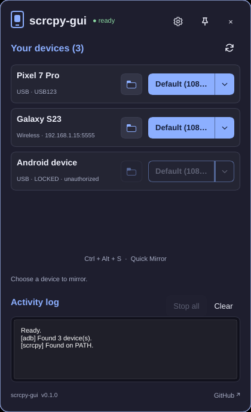
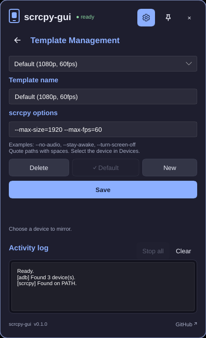
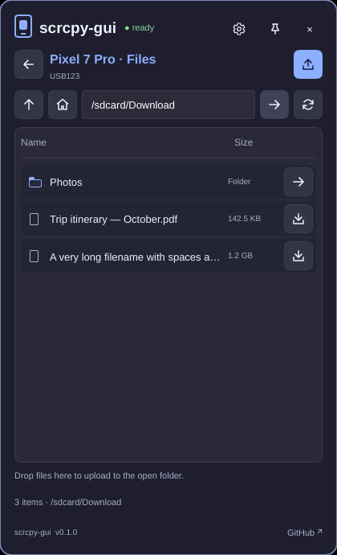
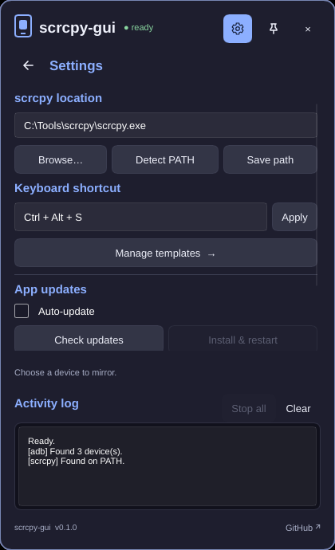

# Features

This guide covers everything scrcpy-gui can do, why each feature is there, and how to use it. For installation, see the [README](../README.md).

scrcpy-gui is a small panel that lives in your system tray. It does not replace [scrcpy](https://github.com/Genymobile/scrcpy). It starts scrcpy for you, using the devices that ADB can see and the presets you have saved. scrcpy and ADB are **not bundled**; install them separately.

- [The tray panel](#the-tray-panel)
- [Devices](#devices)
- [Mirroring](#mirroring)
- [Templates (presets)](#templates-presets)
- [Quick Mirror and the global shortcut](#quick-mirror-and-the-global-shortcut)
- [File explorer](#file-explorer)
- [Settings](#settings)
- [Activity log](#activity-log)
- [Automatic updates](#automatic-updates)
- [Startup at sign-in](#startup-at-sign-in)
- [Command-line options](#command-line-options)
- [Where your data is stored](#where-your-data-is-stored)
- [Platform differences at a glance](#platform-differences-at-a-glance)

---

## The tray panel



The app runs in the background with an icon in the system tray. Clicking the icon opens a compact panel next to the tray, so you can start mirroring without opening a full window.

**Why:** Mirroring a phone is usually something you start and then forget about. A tray app stays out of the way until you need it and doesn't add a window to your taskbar.

- **Open / hide.** Click the tray icon. On Linux, right-click it for **Quick Mirror**, **Show / hide** and **Quit**.
- **Close (×).** Closing hides the panel to the tray; the app keeps running. The next time you open the panel it starts on **Devices**.
- **Pin.** The pin icon in the header keeps the panel open when you click elsewhere, and stays highlighted while it is on. On Windows the panel otherwise hides when it loses focus. On Linux it always stays open until you close it.
- **Settings.** The gear icon opens [Settings](#settings).
- **Quit.** Use **Quit app** in Settings, or **Quit** in the tray menu on Linux, to exit fully and stop all sessions.
- **Footer.** Shows the app version and a link to the GitHub repository. When an update is available, the footer shows a link to it.

Only one copy of the app runs at a time. Launching it again brings the running copy to the front instead of starting a second one.

<br clear="right">

## Devices

The **Devices** page lists every Android device that ADB reports, over USB or over the network (wireless debugging).

**Why:** You shouldn't need a terminal and `adb devices` to see what is connected or why a device won't mirror.

Each device card shows:

- **Name**: the device model, when ADB knows it.
- **Connection**: *USB* or *Wireless*, with the serial or `IP:port`.
- **State**: ready devices can be mirrored. Locked or *unauthorized* devices are shown dimmed, with their mirror button disabled, until you accept the USB-debugging prompt on the phone.

The list refreshes on its own every few seconds while the panel is open. Use the **refresh** icon to update it right away. If the list stays empty or stuck, **Restart ADB** in Settings usually fixes it.

### Connecting a device

1. On the phone, enable **Developer options** and then **USB debugging**.
2. Connect it by USB, unlock it, and accept the **Allow USB debugging?** prompt.
3. For wireless use, pair the device with ADB (`adb pair` / `adb connect`, or Android 11+ **Wireless debugging**). Once ADB lists it, it appears in the panel.

## Mirroring

Each ready device has a mirror button labelled with the [template](#templates-presets) it will use.

- **Start.** Click the template name to start mirroring with that template.
- **Pick another template.** Click the **dropdown arrow** beside it and choose a template. This starts that template once; it does not change your default.
- **Stop.** While a device is mirroring, its button becomes **Stop**. Closing the scrcpy window also ends the session.
- **Stop all.** Stops every running session at once.

You can mirror several devices at the same time. Each one gets its own scrcpy window and can be stopped on its own.

**Why:** scrcpy has many options and you usually want the same few combinations again and again. One click on a device starts exactly the configuration you want.

## Templates (presets)



A template is a named set of scrcpy command-line arguments. Manage them from **Settings → Manage templates**.

**Why:** Templates turn scrcpy's options into reusable presets: one for full quality on a fast USB cable, one for a light stream over Wi-Fi, one without audio, and so on.

The app ships with three:

| Template | Arguments |
|---|---|
| Default (1080p, 60fps) | `--max-size=1920 --max-fps=60` |
| Lightweight (720p, 30fps) | `--max-size=1280 --max-fps=30 --video-bit-rate=4M --no-audio` |
| Full resolution no audio | `--no-audio` |

In the template editor you can:

- Pick a template from the list to edit it, or click **New** to start a new one.
- Give it a **name** and type its **scrcpy options**: any [scrcpy argument](https://github.com/Genymobile/scrcpy#user-documentation), for example `--max-size=1920 --max-fps=60`, `--no-audio` or `--turn-screen-off --stay-awake`. Click **Save** to store it.
- **Delete** removes the selected template. The last remaining template can't be deleted.
- **Make Default** chooses the template used by the device buttons and by [Quick Mirror](#quick-mirror-and-the-global-shortcut). The current default shows **✓ Default**.

Arguments are split using the same quoting rules on every platform, so a template saved on Windows behaves the same on Linux. Wrap values that contain spaces in double quotes. The app runs scrcpy directly, never through a shell, so shell features such as pipes or `$VARIABLES` are not expanded.

<br clear="right">

## Quick Mirror and the global shortcut

**Quick Mirror** starts mirroring with your default template without opening the panel first.

- With **exactly one** ready device, mirroring starts right away.
- With **several** ready devices, the panel opens and asks you to choose one.
- With **none**, the panel opens so you can see why.

**Why:** For the most common case (one phone plugged in) a single key press is all it takes to get your screen on the desktop.

### Windows

The default shortcut is **Ctrl + Alt + S**. Change it in **Settings → Shortcut**. If another app already uses the combination, the app tells you and keeps the previous one.

### Linux

Wayland does not let apps register global keys, and scrcpy-gui never edits your compositor's configuration. Instead, bind a key in your desktop to this command:

```sh
scrcpy-ui --quick-mirror
```

If the app is running, the command asks it to run Quick Mirror and exits immediately. If it is not running, the command starts it and runs Quick Mirror. Use the full path (for example `~/.local/bin/scrcpy-ui`) if the install folder is not on your compositor's `PATH`.

<details>
<summary><b>Examples for Hyprland, Sway, i3, GNOME and KDE</b></summary>

**Hyprland, Lua config** (Omarchy, in `~/.config/hypr/bindings.lua` and `autostart.lua`):

```lua
o.bind("SUPER + CTRL + M", "Quick Mirror", "scrcpy-ui --quick-mirror")
o.launch_on_start("scrcpy-ui --startup")
```

Without Omarchy's helpers: `hl.bind("SUPER + CTRL + M", hl.dsp.exec_cmd("scrcpy-ui --quick-mirror"))`.

**Hyprland, `hyprland.conf`:**

```ini
bind = SUPER CTRL, M, exec, scrcpy-ui --quick-mirror
exec-once = scrcpy-ui --startup
```

**Sway / i3** (`~/.config/sway/config` or `~/.config/i3/config`):

```
bindsym $mod+Ctrl+m exec scrcpy-ui --quick-mirror
exec scrcpy-ui --startup
```

**GNOME:** Settings → Keyboard → View and Customize Shortcuts → Custom Shortcuts, with the command above.

**KDE Plasma:** System Settings → Keyboard → Shortcuts → Add New → Command or Script.

Pick a free combination. On Hyprland, `hyprctl binds` shows what is taken (Omarchy already uses Super + Alt + S).

</details>

## File explorer



Click the **folder icon** to the left of a device's mirror button to browse its storage inside the panel.

**Why:** Copying a screenshot off the phone or a file onto it is the next most common thing people do after mirroring. You shouldn't need a separate tool or `adb push` / `adb pull` for that.

- **Navigate.** Browsing starts at `/sdcard`. Use the **up**, **home** and **refresh** icons, the **arrow** beside a folder to open it, or type an absolute path and press **Enter**.
- **Download.** The **download icon** beside a file opens a Save As dialog. Downloads are saved to a temporary file first, so a failed or cancelled download never overwrites an existing file on your computer.
- **Upload.** Drag files from Explorer or your file manager onto the panel, or use the **upload icon**, to copy them into the open folder. Existing files on the device prompt before they are replaced.
- **Cancel.** The **cancel icon** stops a transfer in progress. An interrupted upload may leave a partial file on the device.
- **Back.** The **back arrow** returns to Devices. The header and version footer stay visible throughout.

The Files page stays open when it loses focus, so you can drag files from another window. Hover over any icon to see its label. Android's normal ADB storage permissions apply: folders such as `/data` are not readable without root.

<br clear="right">

## Settings



Open Settings with the **gear icon** in the header.

- **scrcpy location.** The app looks for scrcpy on your `PATH` at startup. If it is installed elsewhere, use **Browse…** to pick `scrcpy.exe` (Windows) or `scrcpy` (Linux), or type the path and click **Save path**. **Detect PATH** searches `PATH` again. The app uses the `adb` that ships next to scrcpy when there is one, and otherwise the `adb` on your `PATH`. The detected scrcpy version is shown near the bottom.
- **Keyboard shortcut** (Windows only). Type a combination such as `Ctrl + Alt + S` and click **Apply**.
- **Manage templates →** opens the [template editor](#templates-presets).
- **App updates.** **Auto-update**, **Check updates** and **Install & restart**; see [Automatic updates](#automatic-updates).
- **Restart ADB.** Restarts the ADB server. Use this when devices don't appear or stay *offline*. It is unavailable while a device is mirroring.
- **Quit app.** Exits completely.

<br clear="right">

## Activity log

The **Activity log** on the Devices page shows what the app is doing: ADB device scans, scrcpy start and stop, scrcpy's own output, file transfers and update checks. When something fails, the reason is shown here. **Clear** empties it.

**Why:** scrcpy reports problems such as unsupported encoders or a locked device on its console. A tray app has no console, so the app shows that output for you.

## Automatic updates

scrcpy-gui can update itself from the project's [GitHub releases](https://github.com/DeFerence3/scrcpy-gui-slint/releases).

- **Check updates** in Settings looks for a newer release. When one is found, **● Update available** appears in the footer and **Install & restart** downloads it, installs it and restarts the app.
- With **Auto-update** on, the app checks every six hours and installs a new version by itself once no mirroring session is running.
- Installing is unavailable while a device is mirroring, so an update never cuts off a session.
- Every download is checked against the SHA-256 digest that GitHub publishes for the release. If the digest doesn't match, nothing is installed.
- Downloads go through the `gh-proxy.com` mirror first, which helps in regions where GitHub is slow, and fall back to GitHub directly. Because of the digest check, a proxy cannot change what gets installed.

These updates replace **scrcpy-gui only**. Update scrcpy and ADB the way you installed them.

**Linux note:** self-updating works for release tarballs extracted into a folder you can write to without `sudo`, such as `~/.local`. It needs `curl`, `tar` and `sha256sum`. Copies installed under `/usr` or another read-only location, or run from a build folder, only tell you that an update is available; update those the way you installed them.

## Startup at sign-in

- **Windows installer:** the installer registers the app to start in the tray when you sign in, and starts it immediately. Portable ZIP copies don't register for startup.
- **Linux:** add `scrcpy-ui --startup` to your desktop's autostart (see the [shortcut examples](#linux) above). `--startup` starts the app in the tray without showing the panel.

## Command-line options

| Command | What it does |
|---|---|
| `scrcpy-ui` | Starts the app, or shows the panel of the running app. |
| `scrcpy-ui --startup` | Starts in the tray without showing anything (for autostart). |
| `scrcpy-ui --quick-mirror` | Runs Quick Mirror in the running app, or starts the app and runs it. |

## Where your data is stored

| Platform | Settings file |
|---|---|
| Windows | `%APPDATA%\scrcpy-tray\settings.dat` |
| Linux | `$XDG_CONFIG_HOME/scrcpy-tray/settings.dat` (usually `~/.config/scrcpy-tray/settings.dat`) |

The file holds the scrcpy path, the shortcut, the update preference and your templates. It is written to a temporary file and then swapped in, so a crash while saving cannot corrupt it. Delete it to reset everything to defaults. If the file can't be read, the app starts with defaults and leaves the file alone.

## Platform differences at a glance

| | Windows | Linux |
|---|---|---|
| Tray icon | Notification area | StatusNotifierItem (Waybar, Quickshell/Omarchy, KDE, GNOME with the AppIndicator extension, …) |
| Global shortcut | Built in, configurable | Bind `scrcpy-ui --quick-mirror` in your desktop |
| Panel placement | Next to the taskbar tray | Hyprland: floats top-right, pinned across workspaces (set up automatically). Other compositors: add a float rule for app id `scrcpy-gui`. |
| Hide on focus loss | Yes, unless pinned or on Files | No; close with **×** or the tray icon |
| File dialogs | Windows file dialogs | `xdg-desktop-portal` |
| Drag-and-drop upload | Yes | Yes (Wayland sessions) |
| Startup at sign-in | Installer registers it | Add `scrcpy-ui --startup` to autostart |
